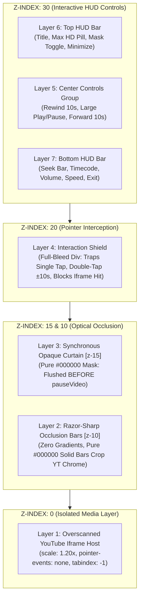
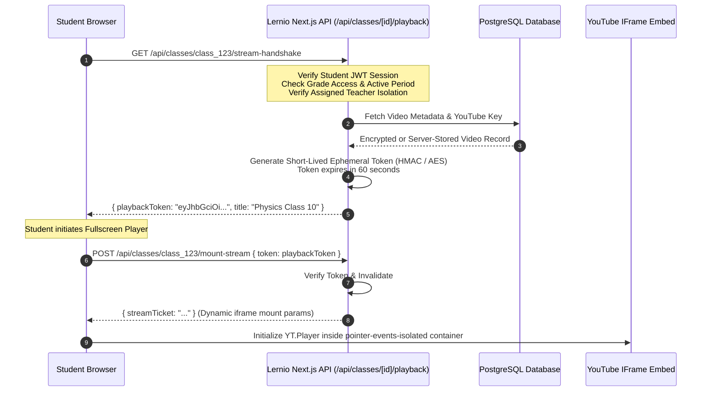

# Technical Specification: Shielded YouTube Cinema Player Architecture

> **Document Type:** AI Agent Implementation Blueprint & Forensic Logic Specification  
> **Target Audience:** Autonomous Coding Agents & Core Systems Engineers  
> **Source Prototype:** [`docs/yt_api/fluent_cinema_yt_player.html`](file:///f:/Projects/lernio/docs/yt_api/fluent_cinema_yt_player.html)  
> **Security Level:** Maximum Protection — Zero Native YouTube UI Leakage & URL Obfuscation  

---

## 1. Executive Problem Statement & Threat Model

### 1.1 Objective
Render and play YouTube video streams inside an educational portal (Lernio) using the official YouTube IFrame Player API, while ensuring:
1. **Zero Link Exfiltration**: Students must never be able to discover the raw YouTube video URL or ID.
2. **Zero Native YouTube Interactivity**: Students must never be able to click through to YouTube, open YouTube's context menu, inspect video titles, or access recommendation grids.
3. **Studio-Grade UX**: The playback experience must feel like a premium, native cinema streaming player with responsive geometry, custom transport controls, instant feedback, and maximum available stream resolution.

### 1.2 Threat Vectors & Attack Surface Matrix

| Threat ID | Threat Vector | Attack Mechanism | Countermeasure in Shielded Player |
| :--- | :--- | :--- | :--- |
| **TV-01** | **Top Chrome Links** | Video title, channel avatar, "Watch later", and "Share" buttons in iframe header navigate to `youtube.com`. | **1.20x Overscan** + **Razor-Sharp Solid `#000000` Top Occlusion Bar** (`height: max(12.5vh, 74px)`). |
| **TV-02** | **Bottom-Right Watermark** | YouTube logo button in lower right corner opens video on YouTube. | **1.20x Overscan** + **Razor-Sharp Solid `#000000` Bottom Occlusion Bar** (`height: max(13.5vh, 86px)`). |
| **TV-03** | **Native Context Menu** | Right-clicking inside iframe reveals "Copy video URL", "Copy embed code", and "Stats for nerds". | **Iframe Pointer Event Nullification** (`pointer-events: none`) + **Global Context Menu Suppressor** (`oncontextmenu="return false;"`) + **Full-Bleed Interaction Shield** (`z-index: 20`). |
| **TV-04** | **Direct Iframe Interaction** | Clicking or tapping iframe directly invokes YouTube's native play/pause/more actions. | **Full-Bleed Interaction Shield (`z-index: 20`)**: Covers 100% of the viewport and traps all pointer/touch/mouse events. |
| **TV-05** | **Keyboard Tab Trapping** | Pressing <kbd>Tab</kbd> navigates focus into iframe anchors, displaying focus rings and allowing <kbd>Enter</kbd> to open YouTube. | **Iframe Tab Index Suppression**: `iframe.setAttribute("tabindex", "-1")` and `iframe.style.userSelect = "none"`. |
| **TV-06** | **Pause Overlay Leaks** | When `pauseVideo()` is called, YouTube instantly displays a video title shelf and related videos drawer. | **Synchronous Style-Flushed Opaque Curtain**: `#opaque-curtain` (`z-index: 15`) is made opaque (`opacity: 1`) and a DOM reflow is synchronously forced (`void el.offsetHeight`) **BEFORE** `pauseVideo()` is invoked. |
| **TV-07** | **End-Screen Recommendation Grid** | When video playback finishes, YouTube covers the screen with a 12-item grid of recommended videos. | **High-Frequency 60FPS Pre-End Interception**: Monitored via `requestAnimationFrame` + `80ms` timer. When `currentTime >= duration - 0.42s`, playback is synchronously paused behind the black curtain before the `ENDED` event ever fires. |
| **TV-08** | **Windowed / Inspect Escape** | Resizing, inspecting, or exiting fullscreen in desktop browsers might expose iframe boundaries. | **Strict Fullscreen-Only Lifecycle**: Session auto-closes immediately if native fullscreen is exited or the browser window/tab is backgrounded (`visibilitychange`). |
| **TV-09** | **Network Payload Inspection** | Students inspecting network tabs or Next.js SSR hydration HTML see `https://www.youtube.com/watch?v=...`. | **Server-Side Tokenization / Ephemeral Playback Handshake**: The backend returns a short-lived, encrypted/signed playback token or proxies the video metadata, never providing raw YouTube URLs in plain props. |

---

## 2. Seven-Layer Optical & Event Isolation Topology

The cinema stage ([`#cinema-stage`](file:///f:/Projects/lernio/docs/yt_api/fluent_cinema_yt_player.html#L348-L352)) uses a strictly ordered z-index stack:

```
┌────────────────────────────────────────────────────────────────────────┐
│ Layer 7: Bottom HUD Deck [z-30] (Seek Bar, Transport, Volume, Speed)  │
│ Layer 6: Top HUD Bar [z-30] (Stream Title, Resolution Pill, Minimize) │
│ Layer 5: Dead-Center Transport Shield [z-30] (Big Play/Replay/Spinner) │
├────────────────────────────────────────────────────────────────────────┤
│ Layer 4: Full-Bleed Interaction Shield [z-20] (Click/Tap/Double-Tap)   │
├────────────────────────────────────────────────────────────────────────┤
│ Layer 3: Synchronous Solid #000000 Curtain [z-15] (Pause/Buffer/End)  │
├────────────────────────────────────────────────────────────────────────┤
│ Layer 2: Razor-Sharp Occlusion Bars [z-10] (Top 12.5vh, Bottom 13.5vh) │
├────────────────────────────────────────────────────────────────────────┤
│ Layer 1: Locked YouTube Embed Layer [z-0] (Overscan 1.20x, No Events)  │
└────────────────────────────────────────────────────────────────────────┘
```

### Detailed Layer Specifications



---

## 3. Mathematical & Geometric Model

### 3.1 Viewport Geometry & Overscan Calculations
The core technique preventing YouTube's top title bar and bottom watermark from appearing is an **optical crop** via CSS scaling and letterboxing:

$$\text{Viewport Aspect Ratio: } R_{vp} = \frac{W_{vw}}{H_{vh}}$$
$$\text{Target Video Aspect Ratio: } R_{vid} = \frac{16}{9} \approx 1.7778$$

```javascript
function computeCinemaViewportGeometry() {
  const vw = window.innerWidth || 1280;
  const vh = window.innerHeight || 720;
  const viewportAspect = vw / vh;
  const targetVideoAspect = 16 / 9;

  let boxW = vw;
  let boxH = vh;

  if (viewportAspect < targetVideoAspect) {
    // Portrait / Mobile: fit width, expand height so chrome is pushed into black bars
    boxW = vw;
    boxH = Math.max(vw / targetVideoAspect, vh * 0.62);
  } else if (viewportAspect > targetVideoAspect) {
    // Ultrawide: expand height to maintain coverage
    boxW = vw;
    boxH = vw / targetVideoAspect;
  }

  // Overscan Scale Factor: 1.20x to 1.22x
  el.ytOverscanBox.style.width = `${Math.ceil(boxW)}px`;
  el.ytOverscanBox.style.height = `${Math.ceil(boxH)}px`;
  el.ytOverscanBox.style.transform = "scale(1.20)";
}
```

### 3.2 Razor-Sharp Cinema Mask Dimensions
Unlike typical video players with semi-transparent vignette gradients, the Shielded Player requires **strictly zero gradients** with solid `#000000` fills and crisp structural borders (`border: 1px solid #16161a`):

| Preset | Label | Top Height | Bottom Height | Minimum Top | Minimum Bottom | Target Aspect |
| :--- | :--- | :--- | :--- | :--- | :--- | :--- |
| **0** | `MASK: 2.35:1` | `12.5dvh` | `13.5dvh` | `74px` | `86px` | CinemaScope Anamorphic |
| **1** | `MASK: 2.00:1` | `10.5dvh` | `11.5dvh` | `68px` | `80px` | Univisium Modern Widescreen |
| **2** | `MASK: 1.85:1` | `9.0dvh` | `10.5dvh` | `64px` | `76px` | Flat Academy Widescreen |

CSS Implementation:
```css
.cinema-bar-top {
  background-color: #000000;
  border-bottom: 1px solid #16161a;
  height: max(12.5dvh, 74px);
}

.cinema-bar-bottom {
  background-color: #000000;
  border-top: 1px solid #16161a;
  height: max(13.5dvh, 86px);
}
```

---

## 4. Algorithmic State Synchronization & Interception Logic

### 4.1 Synchronous Pause Masking Invariant
YouTube's iframe player renders its native pause overlay (title card + related video suggestions shelf) within ~16ms of receiving `pauseVideo()`. To guarantee zero visible flicker:

```
[User Taps Pause / Hits Space]
           │
           ▼
1. state.isPlaying = false;
2. el.opaqueCurtain.style.opacity = "1";
3. updateTransportVisuals("PAUSED");
4. revealHud(true);
           │
           ▼
5. SYNCHRONOUS DOM REFLOW FLUSH:
   void el.opaqueCurtain.offsetHeight; // Forces GPU composition of black curtain
           │
           ▼
6. state.player.pauseVideo();         // YouTube renders pause shelf BEHIND the curtain
```

### 4.2 60FPS Pre-End Interception Protocol
When a video reaches its true end, YouTube renders a 12-recommendation card grid. Standard `YT.PlayerState.ENDED` listeners fire **after** this grid is already rendered.

The Shielded Player eliminates this through **lead-time interception**:

```mermaid
sequenceDiagram
    autonumber
    participant Engine as RAF / 80ms Poller
    participant Player as YouTube IFrame API
    participant Shield as Curtain & Transport HUD

    loop Every Animation Frame
        Engine->>Player: getCurrentTime(), getDuration()
        Player-->>Engine: cur: 239.60s, dur: 240.00s
        Note over Engine: Check: cur >= dur - 0.42s ?
        alt In Interception Window (cur >= dur - 0.42s)
            Engine->>Shield: engageOpaqueCurtain(true, "STREAM COMPLETED")
            Engine->>Shield: Force Reflow (void offsetHeight)
            Engine->>Player: pauseVideo()
            Engine->>Shield: updateScrubberUI(dur, dur)
            Engine->>Shield: setTransportVisuals("ENDED")
            Note over Shield: Replay button active; native end-grid blocked
        else Playing normally
            Engine->>Shield: updateScrubberUI(cur, dur, loadedFraction)
        end
    end
```

### 4.3 Safe Resume Sequence
When resuming from paused or cued state:
1. Video is instructed to play: `state.player.playVideo()`.
2. Curtain remains **solid black (`opacity: 1`)** during buffering.
3. Event `YT.PlayerState.PLAYING` fires.
4. A safety delay of **90ms** elapses to allow the hardware video decoder to blit actual video frames to screen.
5. Only then is `#opaque-curtain` faded out: `engageOpaqueCurtain(false)`.

---

## 5. Pointer Event Scrubbing & Gesture Engine

### 5.1 Unified Pointer Capture
To prevent touch-vs-mouse divergence and ensure scrubbing works identically across iOS, Android, and Desktop:
- All sliders (`#seek-slider`, `#volume-slider`) use `PointerEvent`.
- On `pointerdown`, `element.setPointerCapture(e.pointerId)` is invoked.
- Coordinates are normalized:
  $$\text{Fraction } F = \max\left(0, \min\left(1, \frac{e.clientX - \text{rect.left}}{\text{rect.width}}\right)\right)$$
- On `pointerup` / `pointercancel`, `element.releasePointerCapture(e.pointerId)` is called, and final seek / volume is committed.

### 5.2 Multi-Zone Double-Tap Skip Engine
The `#interaction-shield` partitions horizontal space into 3 zones:
- **Left Zone (< 35% width)**: Double-tap skips backward by `10s` (customizable).
- **Center Zone (35% to 65% width)**: Single tap toggles Play / Pause.
- **Right Zone (> 65% width)**: Double-tap skips forward by `10s` (customizable).
- Double-tap detection window: `< 280ms` between sequential taps on the same side.
- Visual feedback: Animated SVG badge pops at the respective margin (`animate-skip-pop`).

---

## 6. Security & URL Obfuscation Architecture

### 6.1 Vulnerability in Naive Embeds
If client components receive `{ youtubeUrl: "https://youtube.com/watch?v=..." }` or `{ videoId: "UXqq0ZvbOnk" }` in props or JSON payloads, any student opening Chrome DevTools (or inspecting Next.js `__NEXT_DATA__` / hydration props) can easily read the YouTube link.

### 6.2 Bulletproof Handshake Design for Lernio



### 6.3 Player Parameter Hardening
The Iframe API initialization strictly passes:
```javascript
playerVars: {
  autoplay: 1,
  controls: 0,        // Disables native playback controls entirely
  disablekb: 1,       // Disables YouTube keyboard hotkeys
  fs: 0,              // Disables native fullscreen button
  iv_load_policy: 3,  // Disables video annotations
  modestbranding: 1,  // Suppresses YouTube logo
  rel: 0,             // Restricts recommendations to original channel
  playsinline: 1,     // Required for iOS inline execution
  cc_load_policy: 0,  // Captions disabled by default
  origin: window.location.origin
}
```

Immediately upon `onReady`:
```javascript
const iframe = event.target.getIframe();
if (iframe) {
  iframe.setAttribute("tabindex", "-1");
  iframe.style.pointerEvents = "none";
  iframe.style.userSelect = "none";
}
```

---

## 7. Resolution & Quality Ladder Enforcement

YouTube automatically degrades resolution on embedded players based on network heuristics. The Shielded Player overrides this through proactive quality polling:

```javascript
const QUALITY_PRIORITY = [
  "highres",  // 8K / 4K UHD
  "hd2880",   // 5K
  "hd2160",   // 4K
  "hd1440",   // 1440p QHD
  "hd1080",   // 1080p FHD
  "hd720",    // 720p HD
  "large",    // 480p
  "medium",   // 360p
  "small"     // 240p
];

function enforceMaximumVideoQuality(player) {
  if (!player || typeof player.getAvailableQualityLevels !== "function") return;
  const levels = player.getAvailableQualityLevels();
  if (Array.isArray(levels) && levels.length > 0) {
    for (const tier of QUALITY_PRIORITY) {
      if (levels.includes(tier)) {
        player.setPlaybackQuality(tier);
        if (typeof player.setPlaybackQualityRange === "function") {
          player.setPlaybackQualityRange(tier, tier);
        }
        break;
      }
    }
  }
}
```

---

## 8. Fullscreen-Only Lifecycle & Automatic Session Teardown

To guarantee the user cannot inspect or exploit windowed edge gaps:
1. **Entering Playback**:
   - Requires user gesture (<kbd>Launch</kbd> or thumbnail click).
   - Requests `element.requestFullscreen({ navigationUI: "hide" })`.
   - Locks screen orientation to landscape: `screen.orientation.lock("landscape").catch(() => {})`.
2. **Auto-Teardown Triggers**:
   - `fullscreenchange`: If student presses <kbd>Esc</kbd> or swipes out of fullscreen, `isNativeFullscreenActive() === false` immediately stops the video and destroys the session.
   - `visibilitychange`: If student switches tabs or minimizes the window (`document.hidden === true`), session closes instantly.
   - `pagehide`: On browser back or navigate away, session is torn down.

---

## 9. Next.js & React Implementation Blueprint

### 9.1 Component Structure
In the Lernio Next.js application, this system translates into a modular architecture:
- `src/components/player/ShieldedYouTubePlayer.tsx`: The core fullscreen stage component implementing the 7-layer stack, RAF monitor, and pointer events.
- `src/components/player/YouTubePlayerHost.tsx`: Isolated client component that dynamically loads `https://www.youtube.com/iframe_api`.
- `src/components/player/CinemaOcclusionBars.tsx`: Razor-sharp `#000000` masking bars with dynamic aspect ratio presets.
- `src/components/player/PlayerHudTop.tsx` & `PlayerHudBottom.tsx`: Fluent-matte HUD controls with monospace typography and 44px minimum touch targets.

### 9.2 TypeScript Interface Contract

```typescript
export interface ShieldedPlayerConfig {
  /** Video title displayed in HUD */
  title: string;
  /** Ephemeral playback token or validated YouTube video ID */
  videoId: string;
  /** Player behavioral parameters */
  settings?: {
    skipSeconds?: number;
    defaultVolume?: number;
    preferMaxQuality?: boolean;
    autoCloseOnMinimize?: boolean;
    endScreenInterceptLeadSec?: number;
    maskRatioIndex?: number;
  };
  /** Callback fired when student closes the player or exits fullscreen */
  onClose?: () => void;
  /** Callback fired when playback completes */
  onEnded?: () => void;
}
```

---

## 10. AI Implementation Checklist & Critical Invariants

When implementing this system into Lernio:
- [ ] **Invariant 1**: Never allow `pointer-events: auto` on the YouTube iframe or its direct parent container.
- [ ] **Invariant 2**: Always flush DOM styles (`void el.offsetHeight`) between making `#opaque-curtain` visible and calling `pauseVideo()`.
- [ ] **Invariant 3**: Keep the 60fps RAF poller active with an end-screen lead time ($\ge 0.40\text{s}$) to preempt YouTube's recommendation grid.
- [ ] **Invariant 4**: Keep occlusion bars pure `#000000` with zero gradients or transparencies.
- [ ] **Invariant 5**: Maintain minimum touch target size of 44×44px across all HUD interactive controls.
- [ ] **Invariant 6**: Never transmit raw YouTube URLs in plain props to client components; use verified backend access control.
